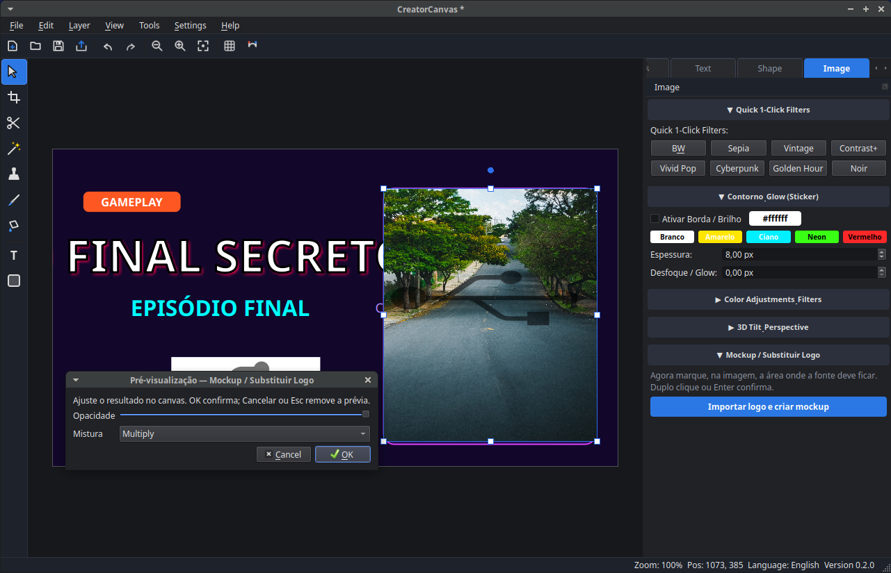
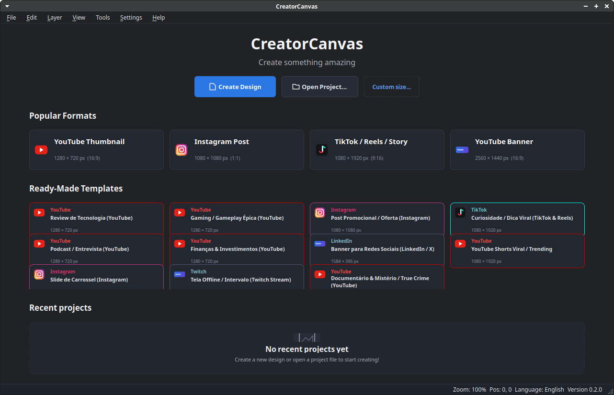
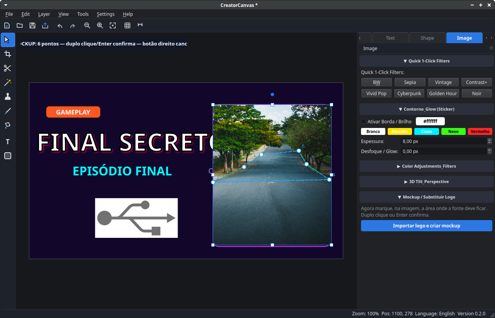
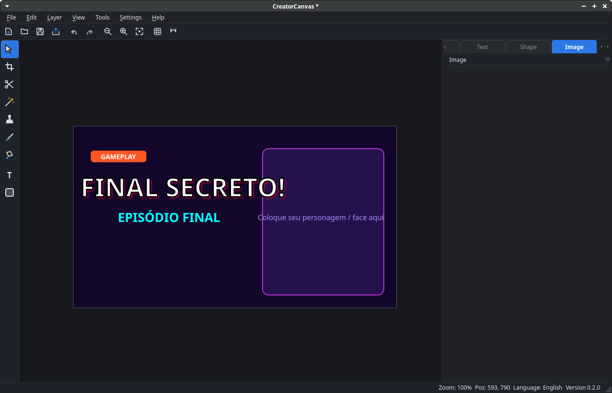
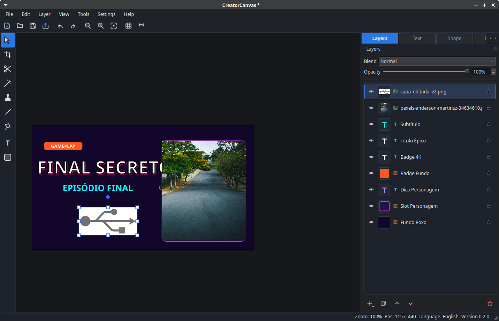

<div align="center">

# 🎨 CreatorCanvas

**Fast, layer-based, non-destructive graphics editor tailored for content creators.**

Create high-impact YouTube thumbnails, social media posts, stories, banners, and marketing assets in minutes — without the complexity of traditional heavyweight photo editors.

[](https://en.wikipedia.org/wiki/C%2B%2B20)
[](https://www.qt.io/)
[](https://cmake.org/)
[](LICENSE)
[](https://github.com/theking1x/creatorcanvas)
[](#)
[](#)

<br/>



*Clean, distraction-free creative workspace with multi-layer editing, transform handles, live inspectors, and safe zones.*

</div>

---

## 🌟 Why CreatorCanvas?

Most photo editing tools are either overly basic web canvas tools or intimidating legacy suites designed for print prepress. **CreatorCanvas** focuses strictly on modern digital creators:

- ⚡ **Lightweight & Blazing Fast** — Pure C++20 with Qt 6. Instant startup, silky-smooth panning/zooming, and minimal memory usage.
- 📐 **Format-First Workflow** — Built-in templates & safe zones for YouTube, Instagram, TikTok, LinkedIn, and Twitter/X.
- 🛡️ **Rock-Solid Stability** — Centralized `DocumentController`, atomic project autosave, and complete crash recovery dialog.
- ✂️ **Non-Destructive Alpha Masks & Selections** — Cut, copy, isolate, and mask raster layers without destroying source pixels.
- 🤖 **Offline AI Background Removal** — Integrated local ONNX model (`u2netp`) removes backgrounds in one click without sending your data to the cloud.
- 📦 **Zero Lock-in** — Projects are stored in `.creatorcanvas` (standard ZIP containing clean PNG assets and readable JSON manifests).

---

## 📸 Visual Showcase

<div align="center">

| Template & Start Screen | Live Mockup & Perspective |
|:---:|:---:|
|  |  |
| *Ready-to-use templates & project browser* | *Free-form 4-point perspective mockup tool* |

| Editable Template Canvas | Mockup Multi-Layer Compositing |
|:---:|:---:|
|  |  |
| *High-contrast typography & visual badges* | *Isolated mockup projection over image layers* |

</div>

---

## 🚀 Key Features

### 🗂️ Layer Engine & Compositing
- **Layer Types**: Image, Text, Shape (Rect, Ellipse, Triangle, Star, Polygon), and Group folders.
- **Organization**: Drag-and-drop reordering, color tags (8 colors), blend modes, lock, and opacity.
- **Alpha Masking**: Non-destructive persistent layer masks saved directly inside project files with render-caching for instant movement.

### ✂️ Centralized Selection & Cut Suite
- **Selection Tools**: Rectangular/Elliptical Marquee (Shift adds, Alt subtracts, feather), Polygonal Scissors, and Magic Wand with adjustable color tolerance.
- **Smart Operations**: Invert selection, clean contour visualization, Copy to new layer, and Cut (creates isolated layer and hides original cleanly).

### ✍️ Typography & Graphic Styling
- Rich text inspector with real-time tracking, bold/italic, drop shadows, multi-stop linear/radial gradients, outline/stroke, texture fills, and hollow knockout text.

### 🎨 Modular Tool Suite (`cc_tools`)
- Selection & Transform (shear, rotate, scale, flip).
- Crop tool with standard aspect presets.
- Raster Brush, Pencil, Airbrush, Eraser, Clone Stamp, and Flood Fill.
- **Gradient** — linear/radial, two colors with alpha, respects the active pixel selection.
- **Retouch brush** — Blur, Sharpen, Smudge, Dodge, Burn and Sponge with size/strength controls.
- **Spot Healing & Red Eye** — automatic nearby-source repair, one undo step per stroke.
- Grouped toolbar with flyout-free organization: selection, cut, paint, retouch, utility and create groups.

### 🖥️ Responsive Layout
- Breakpoint-driven chrome (620 / 980 / 1440 px): the vertical tool rail turns into a compact horizontal bar on narrow or short windows, tool options compact themselves, and inspectors auto-hide with their previous visibility restored.
- Canvas keeps `auto-fit` until you zoom/pan manually; after that, resizing preserves your zoom instead of resetting it.

### 💾 Document Lifecycle & Safety
- **DocumentController**: Centralized engine synchronizing canvas, layers, inspectors, history, and background services.
- **Smart Autosave & Recovery**: Auto-save with dirty-state checks, atomic writes (`.tmp` to target), and interactive crash recovery dialog (Open, Open as Copy, Discard).

### 🌍 Internationalization & Accessibility
- Native multi-language support (English and Portuguese `pt-BR`) with on-the-fly switching.
- New language folders under `resources/locales/` are discovered automatically, but every JSON file must also be listed in `resources/locales.qrc` for the embedded application resource. Translation contributions are welcome; see [Adding or updating a translation](CONTRIBUTING.md#adding-or-updating-a-translation).
- High-contrast dark theme optimized for long editing sessions.

---

## 🛠️ Tech Stack & Architecture

```
CreatorCanvas Architecture
 ├── cc_core          → Document, Layers, History, Serialization, SelectionOps, SnapEngine
 ├── cc_tools         → Modular ICanvasTool suite (Select, Marquee, Crop, Paint, Gradient, Retouch, Healing, Scissors, Wand)
 ├── cc_rendering     → Software QPainter compositor, effects & layer filters
 ├── cc_services      → DocumentController, Autosave, Settings, PresetStore, Logging
 ├── cc_localization  → Dynamic JSON-based i18n service (en, pt-BR)
 └── UI Layer         → MainWindow, CanvasView, Inspectors, History & Recovery Dialogs
```

| Component | Technology | Description |
|---|---|---|
| **Language** | C++20 | Modern idioms, RAII, strict `-Werror` compliance |
| **Framework** | Qt 6 (6.8 LTS) | Qt Widgets, Core, Gui, Test |
| **Build System** | CMake ≥ 3.24 | Presets for Linux (`linux-debug`, `linux-release`) and Windows |
| **Machine Learning** | ONNX Runtime | Local, offline inference (`u2netp.onnx`) |
| **Archive Engine** | miniz | Clean project bundling into `.creatorcanvas` containers |
| **Testing** | QTest / CTest | 31 automated test suites with 100% pass rate |

---

## 📦 Building from Source

### Prerequisites
- C++20 compliant compiler (GCC 11+, Clang 14+, MSVC 2022)
- CMake ≥ 3.24 & Ninja
- Qt 6.x development packages (Core, Gui, Widgets, Test)

### 🐧 Linux (Ubuntu / Debian)

```bash
# 1. Install dependencies
sudo apt update && sudo apt install -y build-essential cmake ninja-build \
    qt6-base-dev qt6-base-dev-tools libgl1-mesa-dev

# 2. Clone repository
git clone https://github.com/MarielCarlosFrias/creatorcanvas.git
cd creatorcanvas

# 3. Fetch AI model and configure
./scripts/fetch_onnx.sh
cmake --preset linux-debug

# 4. Build and run tests
cmake --build build/linux-debug -j$(nproc)
ctest --test-dir build/linux-debug --output-on-failure

# 5. Launch application
./build/linux-debug/bin/CreatorCanvas
```

### 🪟 Windows (MSVC 2022 + Qt 6)

Open the **x64 Native Tools Command Prompt for VS 2022**:

```cmd
scripts\fetch_onnx.bat
cmake --preset windows-release
cmake --build build/windows-release --config Release
ctest --test-dir build/windows-release -C Release --output-on-failure
build\windows-release\bin\Release\CreatorCanvas.exe
```

> **Windows Packaging**: The repository contains pre-configured packaging scripts in `packaging/windows/` (NSIS installer script and portable distribution script).

---

## 🧪 Quality & Testing

Every commit passes a comprehensive verification pipeline:

- **Unit Test Suites**: 31/31 test executables passing (`test_document`, `test_layers`, `test_tools`, `test_serialization`, `test_effects`, etc.).
- **Self-Diagnostic Smoke Test**:
  ```bash
  ./build/linux-debug/bin/CreatorCanvas --smoke-test
  ```
  *Validates locales, ONNX AI inference, ZIP save/load roundtrip, thumbnail generation, and headless UI initialization.*

---

## 🤝 Contribuindo

Contribuições são bem-vindas! Comece por aqui:

1. **Leia o guia completo**: [`CONTRIBUTING.md`](CONTRIBUTING.md) e [`DOCUMENTATION.md`](DOCUMENTATION.md)
2. **Verifique o estado atual**: abra uma issue antes de começar a implementar algo grande
3. **Faça o fork**, crie uma branch (`git checkout -b feat/minha-mudanca`), faça suas alterações e envie um PR
4. **Testes**: todos os 31 testes devem passar (`ctest --output-on-failure`)
5. **Strings de usuário**: nada hardcoded — use `I18nService::t("namespace", "chave")` e adicione à chave tanto em `en` quanto em `pt-BR`
6. **Commits**: use Conventional Commits (`feat:`, `fix:`, `docs:`, `test:`, etc.) ou marque com milestone (`M<n>: <descrição>`)

Leia o [Código de Conduta](CODE_OF_CONDUCT.md) antes de participar.

---

## 📄 License

Distributed under the **MIT License**. See [`LICENSE`](LICENSE) for details.

Third-party components:
- **Qt 6**: LGPLv3 (dynamically linked).
- **ONNX Runtime**: MIT (dynamically linked).
- **miniz**: Public Domain / MIT.

---

<div align="center">
Made with passion for creators. Star ⭐ this repository if you find it useful!
</div>
