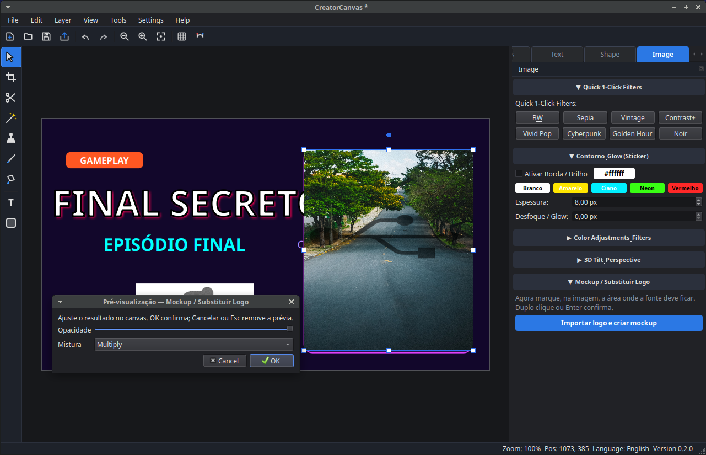
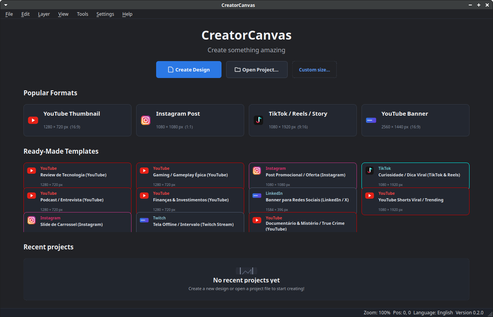
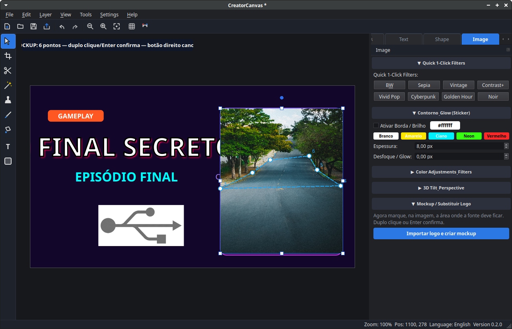
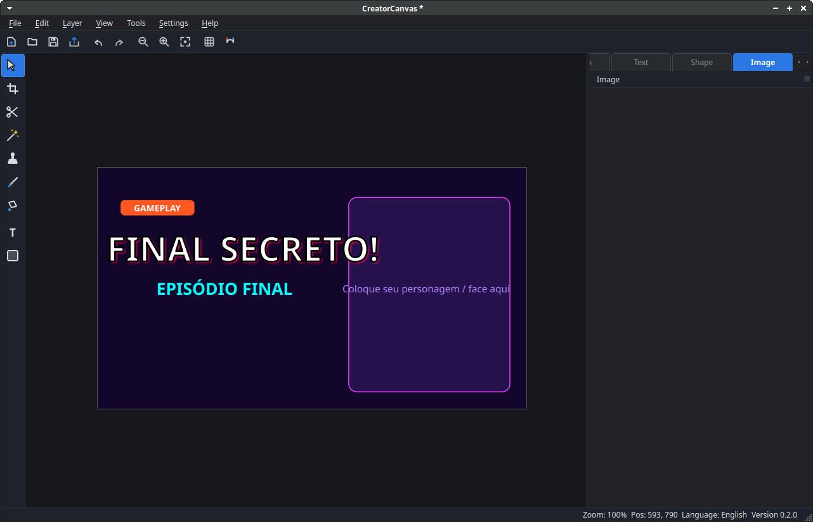
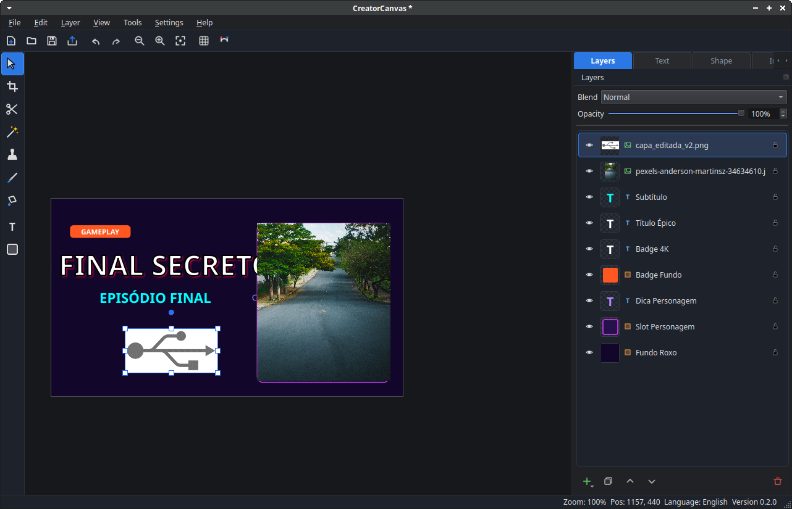

<div align="center">

# 🎨 CreatorCanvas

**Fast, layer-based, non-destructive graphics editor tailored for content creators.**

Create high-impact YouTube thumbnails, social media posts, stories, banners, and marketing assets in minutes — without the complexity of traditional heavyweight photo editors.

[](https://en.wikipedia.org/wiki/C%2B%2B20)
[](https://www.qt.io/)
[](https://cmake.org/)
[](LICENSE)
[](https://github.com/MarielCarlosFrias/creatorcanvas)
[](#)
[](#)

<br/>



*Clean, distraction-free creative workspace with multi-layer editing, transform handles, live inspectors, and safe zones.*

</div>

---

## 🌟 Why CreatorCanvas?

Most photo editing tools are either overly basic web canvas tools or intimidating legacy suites designed for print prepress. **CreatorCanvas** focuses strictly on modern digital creators:

- ⚡ **Lightweight & Blazing Fast** — Pure C++20 with Qt 6. Instant startup, silky-smooth panning/zooming, and minimal memory usage — with a configurable history memory budget and a render cache that adapts to your machine's RAM.
- 📐 **Format-First Workflow** — Built-in templates & safe zones for YouTube, Instagram, TikTok, LinkedIn, and Twitter/X.
- 🛡️ **Rock-Solid Stability** — Centralized `DocumentController`, atomic project autosave, and complete crash recovery dialog.
- ✂️ **Non-Destructive Alpha Masks & Selections** — Cut, copy, isolate, and mask raster layers without destroying source pixels.
- 🤖 **Offline AI Background Removal** — Integrated local ONNX model (`u2netp`) removes backgrounds in one click without sending your data to the cloud.
- 📦 **Zero Lock-in** — Projects are stored in `.creatorcanvas` (standard ZIP containing clean PNG assets and readable JSON manifests).

---

## 📸 Visual Showcase

<div align="center">

| Template & Start Screen | Live Mockup & Perspective |
|:---:|:---:|
|  |  |
| *Ready-to-use templates & project browser* | *Free-form 4-point perspective mockup tool* |

| Editable Template Canvas | Mockup Multi-Layer Compositing |
|:---:|:---:|
|  |  |
| *High-contrast typography & visual badges* | *Isolated mockup projection over image layers* |

</div>

---

## 🚀 Key Features

### 🗂️ Layer Engine & Compositing
- **Layer Types**: Image, Text, Shape (Rect, Rounded Rect, Ellipse, Triangle, Star, Polygon, Badge, Speech Bubble, Heart, Arrows and more — 18 kinds), Fill, Adjustment, Vector (Bézier), and Group folders.
- **Organization**: Drag-and-drop reordering, color tags (8 colors), blend modes (12), opacity + fill opacity, granular per-pixel locks, and layer link groups.
- **Clipping Masks**: Clip a layer to the one below it (Photoshop-style) — works inside groups too, via `Layer ▸ Create Clipping Mask` (`Ctrl+Alt+G`).
- **Alpha Masking**: Non-destructive persistent layer masks saved directly inside project files with render-caching for instant movement.
- **Adjustment Layers & Smart Filters**: Levels, Curves, Brightness/Contrast, Hue/Saturation, Color Balance, Photo Filter, Channel Mixer, Invert, Threshold, Posterize and Gradient Map, plus Blur, Motion Blur, Noise, Twirl, Pinch and Ripple as editable non-destructive adjustment layers by default (destructive mode remains optional).

### 🖼️ Image, Canvas & Export
- **Image Size / Resample**: resample image assets and masks with Nearest Neighbor, Bilinear or Bicubic, preserving selections, guides, slices and undo/redo without cumulative resampling.
- **Canvas Size / Rotate Canvas**: crop/expand or rotate the canvas independently of Image Size.
- **Rulers & draggable guides**: pull horizontal/vertical guides directly from the rulers; guides persist in the project.
- **Batch processing**: resize and convert PNG/JPEG/WebP, import flattened PSD composites, and export PDF/SVG.

### ✂️ Centralized Selection & Cut Suite
- **Selection Tools**: Rectangular/Elliptical Marquee (Shift adds, Alt subtracts, feather), Polygonal Scissors, and Magic Wand with adjustable color tolerance.
- **Select Subject (AI)**: one click turns the local ONNX model into a pixel selection of the subject — the background is kept, so you can copy the subject to a new layer, feather the edge or composite it over another image (`Ctrl+Alt+S`).
- **Smart Operations**: Invert selection, clean contour visualization, Copy to new layer, Cut (creates isolated layer and hides original cleanly), and **Transform Selection** to move/scale/rotate only the selection outline with undo and explicit Document/Layer space.

- **Refine Edge** (advanced mode) — smooth, expand/contract and feather the active selection with a live mask preview, applied as a single undo step.
- **Text-style presets** — save a text layer's look (font, colour, outline, shadow, gradient) and re-apply it in one click; four built-in creator styles ship with the app (advanced mode).
- **Adjustments, two ways** (`Image ▸ Adjustments`): brightness/contrast, hue/saturation, **shadows/highlights**, **vignette**, invert, posterize, threshold, levels, curves (per channel), channel mixer and gradient map — with live preview and a non-destructive default. In advanced mode the image inspector also gets a live adjustments section bound to the layer's adjustment layer (never baking pixels, one undo per slider drag).

### ✍️ Typography & Graphic Styling
- Rich text inspector with real-time tracking, bold/italic, drop shadows, two-stop linear/radial gradients, outline/stroke, texture fills, and hollow knockout text.

### 🎨 Modular Tool Suite (`cc_tools`)
- Selection & Transform (shear, rotate, scale, flip).
- Crop tool with standard aspect presets.
- Raster Brush, Pencil, Airbrush, Eraser, Clone Stamp, and Flood Fill.
- **Pen tool** — cubic Bézier paths with editable nodes and handles (`P`); in advanced mode a node editor (`A`) moves/inserts/deletes nodes and reshapes curves with one undo step per gesture.
- **Gradient** — linear/radial, two colors with alpha, respects the active pixel selection.
- **Text on path** (advanced mode) — glue text to a Bézier path from the pen tool and slide it along the curve. Shape/background fills additionally support **multi-stop** ramps and **conical** sweeps (advanced mode).
- **Retouch brush** — Blur, Sharpen, Smudge, Dodge, Burn and Sponge with size/strength controls.
- **Spot Healing & Red Eye** — right-click (or `Shift`+click) sets the healing source, then paint to heal; one undo step per stroke.
- **Perspective Mockup** — 4-point warp with live preview and free-form mode (`Esc` cancels).
- Toolbar consolidated into 9 Photoshop-style flyout slots: click-hold a slot to reach its sibling tools, `Shift`+slot key to cycle (same actions in the **Tools** menu).

### 🖥️ Responsive Layout & Workspace
- Breakpoint-driven chrome (620 / 980 / 1440 px): the vertical tool rail turns into a compact horizontal bar on narrow or short windows, tool options compact themselves, and inspectors auto-hide with their previous visibility restored.
- Canvas keeps `auto-fit` until you zoom/pan manually; after that, resizing preserves your zoom instead of resetting it.
- **Numeric transform**: X/Y/W/H/rotation fields for the selected layer, aspect-locked, one undo step per drag.
- **Workspace layouts** — save, restore and delete named dock layouts (`Window ▸ Workspace Layout`).
- **Customizable shortcuts** — reassign any action in `Help ▸ Keyboard Shortcuts`; overrides persist across sessions.
- **Command palette** — press `Ctrl+K` (or `Help ▸ Command Palette…`) and type to find *any* command by name — menus, tools, shapes, filters and adjustments included — then `Enter` to run it. No more hunting through 11 menus.
- **One-click PNG copy** — `Ctrl+Shift+E` (`File ▸ Save PNG Copy…`) exports the whole document as PNG in a single file dialog and confirms in the status bar.
- **Simple mode by default** — the app starts with only the essential tools; professional surfaces (histogram, node editing, Refine Edge, multi-stop gradients, text on path) appear when you switch **Advanced Mode** — now also a checkbox in `Settings`, applying immediately.
- **Beginner help everywhere** — every tool explains itself in the status bar when you pick it, an empty canvas tells you how to start (drag an image, `T` for text, `Ctrl+K` for commands), a one-time tips bar introduces `Ctrl+K`, and the start screen's empty state links straight to the shortcut list and to sample projects.
- **71 built-in resources across three packs** — the Starter Pack (23 backgrounds, textures and YouTube end screens), a Textures pack (32: papers, cracked wall, carpet, plastics, topographic and abstract) and an Overlays pack (16 dust/noise/grunge PNGs that apply with Screen blending). Browse from the start screen or `Ctrl+B`; picking a background with no document open starts a canvas at that exact size.
- **12 ready-to-edit sample projects** — four of them built on the pack: thumbnail, YouTube end screen, Instagram post and channel banner, all listed as cards on the start screen.
- **A guided first run** — a one-time welcome dialog asks for your language, a 4-step **Quick tour** (Help ▸ Quick tour) points at the tool bar, options, layers and export, and a **First steps** panel ticks off "create a document → add a layer → arrange → export" until you're ready to work alone.

### 💾 Document Lifecycle & Safety
- **DocumentController**: Centralized engine synchronizing canvas, layers, inspectors, history, and background services.
- **Smart Autosave & Recovery**: Auto-save with dirty-state checks, atomic writes (`.tmp` to target), and interactive crash recovery dialog (Open, Open as Copy, Discard).
- **Batch processing**: apply a set of operations to many files at once (`File ▸ Batch`).
- **Layer Comps & Web Slices**: save and apply named layer states (single undo step), and export named rectangles of the canvas for the web — slices are drawn on the canvas with their name and format (`Layer ▸ Layer Comps`, `File ▸ Web Slices`).

### 🆕 CreatorCanvas 0.3 — Productivity & Interoperability
- **Multi-layer clipboard** — Copy/Cut/Paste across documents with asset and adjustment-link remapping, plus **Paste Into Selection** mapped from document space to the pasted bitmap.
- **Persistent selection channels** — named document/layer-space selections survive project save/load; **Reselect**, **Fill**, **Stroke** and **Clear** are undoable.
- **Canvas Size & Rotate Canvas** — with anchor selection and coherent selection, guide and web-slice transforms, including undo/redo.
- **Filter gallery** — Gaussian/Motion Blur, monochrome or colour Noise, and Twirl/Pinch/Ripple distortions, computed asynchronously with selection and lock awareness.
- **Hybrid SVG & PDF export** — vector content is preserved where supported; **minimal PSD import** handles flattened 8/16-bit grayscale/RGB files, raw or PackBits RLE.
- **Navigator & Swatches docks**, rulers, persistent guides and a status-bar colour readout.
- **Rendering correctness & speed** — cached blend modes, bounded composite caches, masked effects, and group/re-parent transforms that preserve nested flip/shear/rotation.

### 🌍 Internationalization & Accessibility
- Native multi-language support (English, Portuguese `pt-BR` and Swedish `sv`) with on-the-fly switching.
- New language folders under `resources/locales/` are discovered automatically, but every JSON file must also be listed in `resources/locales.qrc` for the embedded application resource. Translation contributions are welcome; see [Adding or updating a translation](CONTRIBUTING.md#-adicionando-ou-atualizando-uma-tradução).
- High-contrast dark theme optimized for long editing sessions.

---

## 🛠️ Tech Stack & Architecture

```
CreatorCanvas Architecture
 ├── cc_core          → Document, Layers, History, Serialization, SelectionOps, SnapEngine, ImageProcessing, ONNX
 ├── cc_tools         → Modular ICanvasTool suite (Select, Marquee, Crop, Paint, Pen, Gradient, Retouch, Healing, Scissors, Wand, Clone, Flood)
 ├── cc_rendering     → Software QPainter compositor, effects & layer filters
 ├── cc_services      → DocumentController, Autosave, Settings, PresetStore, Logging
 ├── cc_localization  → Dynamic JSON-based i18n service (en, pt-BR, sv)
 └── UI Layer         → MainWindow, CanvasView, Inspectors, History & Recovery Dialogs
```

| Component | Technology | Description |
|---|---|---|
| **Language** | C++20 | Modern idioms, RAII, strict `-Werror` compliance |
| **Framework** | Qt 6 (6.8 LTS reference) | Qt Widgets, Core, Gui, Test — builds with Qt ≥ 6.2 |
| **Build System** | CMake ≥ 3.24 | Presets for Linux (`linux-debug`, `linux-release`, `linux-asan`) and Windows |
| **Machine Learning** | ONNX Runtime | Local, offline inference (`u2netp.onnx`) |
| **Archive Engine** | miniz | Clean project bundling into `.creatorcanvas` containers |
| **Compositor** | `IRenderer` seam | Software QPainter renderer + per-layer pixmap cache (text/shape/vector/fill, revision-keyed, LRU) |
| **Testing** | QTest / CTest | 40 automated test suites with 100% pass rate |

---

## 📦 Building from Source

### Prerequisites
- C++20 compliant compiler (GCC 11+, Clang 14+, MSVC 2022)
- CMake ≥ 3.24 & Ninja
- Qt 6.x development packages (Core, Gui, Widgets, Test)
- **SFML 3.0** (Graphics, Window, System) — powers *Image ▸ Edit in MiniPaint*; without it the editor is simply not built

### 🐧 Linux (Ubuntu / Debian)

```bash
# 1. Install dependencies
sudo apt update && sudo apt install -y build-essential cmake ninja-build \
    qt6-base-dev qt6-base-dev-tools libgl1-mesa-dev

# 2. Clone repository
git clone https://github.com/MarielCarlosFrias/creatorcanvas.git
cd creatorcanvas

# 3. Fetch AI model and configure
./scripts/fetch_onnx.sh
cmake --preset linux-debug

# 4. Build and run tests
cmake --build build/linux-debug -j$(nproc)
ctest --test-dir build/linux-debug --output-on-failure

# 5. Launch application
./build/linux-debug/bin/CreatorCanvas
```

### 🪟 Windows (MSVC 2022 + Qt 6)

Open the **x64 Native Tools Command Prompt for VS 2022**:

```cmd
scripts\fetch_onnx.bat
cmake --preset windows-release
cmake --build build/windows-release --config Release
ctest --test-dir build/windows-release -C Release --output-on-failure
build\windows-release\bin\Release\CreatorCanvas.exe
```

> **Windows Packaging**: The repository contains pre-configured packaging scripts in `packaging/windows/` (NSIS installer script and portable distribution script).

> **Built-in external editor**: *Image ▸ Edit in MiniPaint* launches `minipaint-standalone`, built in-tree from the vendored module in `3rdparty/minipaint` (SFML 3). It lands in `bin/` beside `CreatorCanvas`, is shipped by the install rules and bundled with its SFML libraries in the packages. To build a different checkout instead, set `-DCC_MINIPAINT_SOURCE_DIR=/path/to/minipaint`, or disable it with `-DCC_MINIPAINT_SOURCE_DIR=OFF` (then `CC_MINIPAINT_BINARY`/`PATH` discovery still applies).

---

## 🧪 Quality & Testing

Every commit passes a comprehensive verification pipeline:

- **Unit Test Suites**: 54/54 test executables passing (`test_document`, `test_layers`, `test_tools`, `test_serialization`, `test_effects`, `test_layer_clipboard`, `test_selection_transform`, `test_image_size`, `test_smart_filters`, `test_batch`, `test_panels`, etc.).
- **Self-Diagnostic Smoke Test**:
  ```bash
  ./build/linux-debug/bin/CreatorCanvas --smoke-test
  ```
  *Validates locales, ONNX AI inference, ZIP save/load roundtrip, thumbnail generation, and headless UI initialization.*
- **UI Snapshot** (layout regression):
  ```bash
  QT_QPA_PLATFORM=offscreen ./build/linux-debug/bin/CreatorCanvas --ui-snapshot /tmp/shots
  ```
  *Renders the editor at five window sizes for every tool so responsive layout regressions can be reviewed headlessly.*

---

## 🤝 Contribuindo

Contribuições são bem-vindas! Comece por aqui:

1. **Leia o guia completo**: [`CONTRIBUTING.md`](CONTRIBUTING.md) e [`DOCUMENTATION.md`](DOCUMENTATION.md)
2. **Verifique o estado atual**: abra uma issue antes de começar a implementar algo grande
3. **Faça o fork**, crie uma branch (`git checkout -b feat/minha-mudanca`), faça suas alterações e envie um PR
4. **Testes**: os 54 testes automatizados ativos devem passar (`ctest --output-on-failure`; o smoke test interativo do MiniPaint fica desativado por padrão quando não há display)
5. **Strings de usuário**: nada hardcoded — use `I18nService::t("namespace", "chave")` e adicione a chave em todos os catálogos embarcados (`en`, `pt-BR`, `sv`)
6. **Commits**: use Conventional Commits (`feat:`, `fix:`, `docs:`, `test:`, etc.) ou marque com milestone (`M<n>: <descrição>`)

Leia o [Código de Conduta](CODE_OF_CONDUCT.md) antes de participar.

---

## 📄 License

Distributed under the **MIT License**. See [`LICENSE`](LICENSE) for details.

Third-party components:
- **Qt 6**: LGPLv3 (dynamically linked).
- **ONNX Runtime**: MIT (dynamically linked).
- **miniz**: Public Domain / MIT.

---

<div align="center">
Made with passion for creators. Star ⭐ this repository if you find it useful!
</div>
